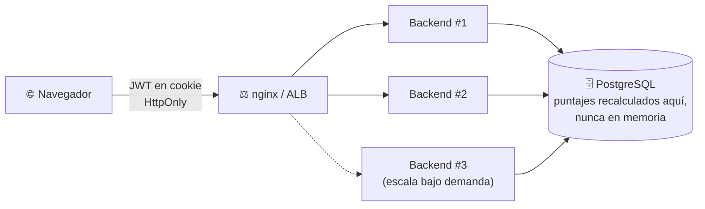
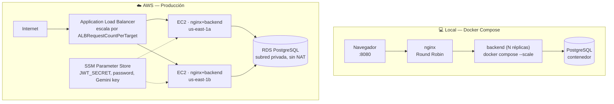

<div align="center">

# ⚽ Predicciones del Mundial

### Predice resultados, acumula puntos, compite en salas — con escalamiento real en AWS

[](https://www.python.org/)
[](https://fastapi.tiangolo.com/)
[](https://react.dev/)
[](https://www.postgresql.org/)
[](https://aws.amazon.com/)
[](https://docs.docker.com/compose/)

</div>

---
## 📌 Video Drive
**Link:** https://drive.google.com/drive/folders/1QrblexjUeZ2bB1B1THecci-DgUKv2yBf?usp=sharing

---

## 📌 Sobre este proyecto

**GLAB-S12** — *Desarrollo de Soluciones en la Nube*, Tecsup (laboratorio calificado, semana de evaluación).

Como el Mundial 2026 ya se jugó, los partidos de esta aplicación son **simulados**: un administrador los crea con fechas relativas a "ahora" y registra sus resultados, lo que dispara el recálculo de puntajes de todos los usuarios. El objetivo del laboratorio no es la exactitud futbolística, sino demostrar de punta a punta un sistema **sin estado en el servidor** (JWT en cookie, puntajes recalculados en la base de datos) que escala horizontalmente de verdad, con evidencia real de AWS creciendo y reduciendo instancias bajo carga.

### Principio central: nada vive en la memoria de un servidor



Cualquier instancia puede atender cualquier petición de cualquier usuario — es lo que permite que el Auto Scaling Group crezca o se reduzca sin que nadie pierda su sesión ni sus datos.

---

## 🏆 Las 5 reglas de puntuación

| Regla | Condición | Puntos |
|---|---|---|
| 1 — Marcador exacto | Acierta el resultado exacto | +5 |
| 2 — Ganador correcto | Acierta quién gana (o el empate) | +3 |
| 3 — Diferencia de goles | Acierta el margen de victoria | +2 |
| 4 — Racha | Cada 3 partidos consecutivos acertando al menos al ganador | +2 |
| 5 — Anticipación | Predicción registrada con más de 24 h de anticipación (y que puntuó) | +1 |

Las reglas 1-3 son **acumulables**, no excluyentes — así la regla 3 sí llega a aplicarse (si fuera excluyente, acertar la diferencia de goles implicaría siempre haber acertado también al ganador, un puntaje mayor, y la regla 3 nunca se alcanzaría). Los puntajes base posibles son:

| Resultado de la predicción | Puntaje |
|---|---|
| Marcador exacto | **10** (5+3+2) |
| Ganador + diferencia, sin marcador exacto | **5** (3+2) |
| Solo el ganador | **3** |
| Nada acertado | **0** |

---

## 🧭 Funcionalidad

| Módulo | Qué hace |
|---|---|
| **Autenticación** | Registro abierto (correo + apodo público + contraseña), sesión en cookie `HttpOnly`, roles `USER`/`ADMIN` |
| **Partidos** | El admin crea, edita y registra resultados; las predicciones se cierran automáticamente al iniciar el partido |
| **Ranking** | Global y por sala, con desempate por exactos → aciertos → apodo |
| **Salas** | Grupos privados por código de invitación de 8 caracteres; el dueño expulsa, regenera el código o elimina la sala |
| **Estadísticas** | Calculadas (% de aciertos, mejor racha, comparación con el promedio) + análisis opcional con la API de **Gemini** |

---

## ⚙️ Stack

Versiones verificadas el 2026-11-04.

| Capa | Tecnología |
|---|---|
| Backend | FastAPI 0.162 · SQLAlchemy 2.1.8 · Alembic · psycopg 3.3.8 · PyJWT · bcrypt · Python 3.14 |
| Frontend | React 19.3 · Vite 8.3 · TypeScript 7.0 |
| Base de datos | PostgreSQL 18 (local: contenedor · AWS: RDS) |
| Pruebas | pytest 9.2 + pytest-cov · Playwright 1.64 · Locust 2.47 |
| IA (opcional) | `google-genai` 2.34, modelo configurable (`GEMINI_MODEL`) |

---

## 🏗️ Arquitectura

Misma pareja de contenedores (**nginx + backend**) en ambos entornos; solo cambia la infraestructura alrededor.



- **Sin NAT Gateway**: las instancias del Auto Scaling Group viven en subredes *públicas* con salida directa a Internet; solo RDS va en subredes privadas, sin necesitar salir a Internet.
- **Sin SSH**: acceso a las instancias por AWS Session Manager.
- **Escalamiento por tráfico, no por CPU**: el umbral de `ALBRequestCountPerTarget` se alcanza con una carga modesta, generable desde cualquier PC — sin tener que levantar una instancia extra solo para producir carga.

Diagrama completo y evidencia de un escalamiento real (2 → 3 → 2 instancias) en el informe del laboratorio.

---

## 🚀 Puesta en marcha

<details>
<summary><strong>Desarrollo local con Docker Compose</strong></summary>

<br>

Requisito: Docker Desktop.

```bash
git clone https://github.com/diegoninam-ship-it/Lab12-DSN.git
cd Lab12-DSN
cp backend/.env.example backend/.env   # JWT_SECRET >= 32 caracteres, ADMIN_*, etc.
docker compose up --build
```

Accede en `http://localhost:8080` (nginx sirve el frontend y balancea `/api/` hacia el backend). La migración y el seed de datos demo corren **una sola vez**, en el servicio `migrate` — nunca al arrancar `backend`.

**Usuarios de demostración** (creados por el seed):

| Apodo | Correo | Contraseña | Rol | Regla que ilustra |
|---|---|---|---|---|
| `admin` | `ADMIN_EMAIL` del `.env` | `ADMIN_PASSWORD` del `.env` | ADMIN | — |
| `exacto1` | `exacto1@demo-mundial.com` | `Demo12345` | USER | Marcador exacto (10 pts) |
| `difer1` | `difer1@demo-mundial.com` | `Demo12345` | USER | Ganador + diferencia (5 pts) |
| `ganador1` | `ganador1@demo-mundial.com` | `Demo12345` | USER | Solo el ganador (3 pts) |
| `rachero` | `rachero@demo-mundial.com` | `Demo12345` | USER | Racha de 6 aciertos (+4) |
| `anticipado` | `anticipado@demo-mundial.com` | `Demo12345` | USER | Bonus de anticipación (+1) |

Para refrescar las fechas de los partidos demo antes de una presentación en vivo:

```bash
docker compose run --rm migrate sh -c "alembic upgrade head && python -m app.seed --reiniciar"
```

**Para probar el balanceo real:**

```bash
docker compose up -d --scale backend=3
```

El pie de página de la app muestra **"Atendido por: ..."** con el `SERVER_ID` real de la instancia que respondió — confirma el balanceo a simple vista. `frontend/nginx.conf` usa el resolver interno de Docker (`127.0.0.11`) con re-resolución dinámica (`server backend:8000 resolve;`) y una `zone` compartida para el Round Robin, así que no hace falta reiniciar nginx al escalar: las réplicas nuevas se detectan solas dentro del TTL del resolver (verificado contra `nginx 1.31.6` de la imagen `nginx:alpine`, que soporta `resolve` en open source desde la 1.27.3 — sin la directiva `zone`, cada *worker* de nginx llevaría su propio contador de Round Robin y la distribución saldría sesgada).

</details>

<details>
<summary><strong>Frontend por separado (opcional)</strong></summary>

<br>

```bash
cd frontend
npm install
npm run dev
```

Requiere el backend corriendo (`docker compose up db migrate backend`). `vite.config.ts` incluye un proxy de `/api` hacia `http://localhost:8000` solo para este modo de desarrollo — el navegador sigue viendo un único origen, igual que en producción detrás de nginx.

</details>

<details>
<summary><strong>Pruebas automatizadas</strong></summary>

<br>

```bash
docker compose run --rm backend sh -c "pip install -q -r requirements-dev.txt && pytest -q --cov=app --cov-report=term-missing"
```

103 pruebas (pytest) + 4 E2E (Playwright) + 2 corridas de estrés locales, todas en verde. Cobertura: **99%** (`app/seed.py` excluido a propósito — ver `docs/PRUEBAS.md`).

</details>

<details>
<summary><strong>Prueba de estrés con Locust</strong></summary>

<br>

```bash
docker compose up -d --scale backend=1   # o =3, para comparar
locust -f loadtest/locustfile.py --host http://localhost:8080 \
  --headless -u 50 -r 10 -t 2m --csv docs/resultado --html docs/resultado.html
```

Escenario realista: login, listar partidos, consultar rankings, predecir un partido al azar y ver estadísticas — nunca el endpoint de IA (fuera del alcance del estrés, para no medir la latencia de una API externa).

</details>

<details>
<summary><strong>Despliegue en AWS</strong></summary>

<br>

`docker-compose.aws.yml` (sin `db` ni `migrate`) corre `backend` + `frontend` dentro de cada instancia del Auto Scaling Group, detrás de un ALB. RDS PostgreSQL vive aparte, en subredes privadas.

**1. Construir y subir las im\u00e1genes a Docker Hub** (arquitectura fijada expl\u00edcitamente, independiente de la m\u00e1quina de build):

```bash
docker buildx build --platform linux/amd64 -t diegozx/lab12-backend:latest --push ./backend
docker buildx build --platform linux/amd64 -t diegozx/lab12-frontend:latest --push ./frontend
```

**2. En cada instancia** (vía *user data*), las variables de entorno (`DATABASE_URL`, `JWT_SECRET`, `SERVER_ID`, etc.) se leen desde SSM Parameter Store al arrancar — ninguna instancia necesita un archivo `.env` provisto a mano:

```bash
docker compose -f docker-compose.aws.yml up -d
```

**3. Migración y seed, una sola vez**, a mano, desde cualquier instancia vía Session Manager (nunca en el *user data* de cada instancia, para no repetirlos en cada escalado):

```bash
docker compose -f docker-compose.aws.yml exec backend alembic upgrade head
docker compose -f docker-compose.aws.yml exec backend python -m app.seed
```

El resto de la infraestructura (VPC, grupos de seguridad, ALB, Auto Scaling Group, RDS, SSM) se detalla en el informe del laboratorio, junto con la evidencia de un escalamiento real (2 → 3 → 2 instancias) bajo carga generada con Locust.

</details>

---

## 📂 Estructura

```
Lab12-DSN/
├── backend/          # FastAPI: routers, modelos, motor de puntuación, pruebas
├── frontend/         # React 19 + TypeScript + Playwright (e2e/)
├── loadtest/         # locustfile.py — escenario de estrés
├── docker-compose.yml
├── docker-compose.aws.yml
├── docs/
│   ├── PRUEBAS.md            # detalle completo de T1–T5 + Etapa 4 (AWS)
│   ├── locust-1-backend.html
│   ├── locust-3-backends.html
│   └── locust-aws-alb.html
└── .env.example
```

---

<div align="center">

**Curso:** Desarrollo de Soluciones en la Nube · **Institución:** Tecsup
**Laboratorio:** GLAB-S12 — Predicciones del Mundial (laboratorio calificado)

</div>